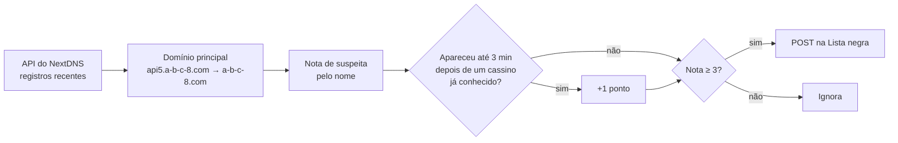

# Bloqueador de Cassino

Ferramenta que lê os registros de DNS de um perfil **NextDNS**, reconhece os domínios descartáveis usados pelos apps de cassino ilegal (os "tigrinhos") e os coloca na Lista negra automaticamente. Roda sozinha a cada 5 minutos num **Cloudflare Worker** (plano gratuito, sem servidor e sem computador ligado), ou no seu computador com o script em Python.

Os apps de cassino ilegal trocam de domínio a cada poucos minutos (`x8s9m0q.com`, `r8x1m4k.com`, `uhrsgh91.com`...). As listas prontas e a lista negra manual não acompanham essa troca. O script parte de outra ideia: em vez de saber **quais** domínios bloquear, ele reconhece o **padrão** dos nomes.

> **Uso com consentimento.** A ferramenta foi pensada para quem quer se proteger, ou proteger outra pessoa adulta **com o consentimento dela**. Ela atua no DNS do aparelho, que precisa estar configurado para usar o perfil NextDNS.

---

## Problema

Um aparelho com um desses apps consulta dezenas de domínios aleatórios por hora. A categoria "Jogos de azar" e a lista negra manual não pegam domínios recém-criados. A detecção de ameaças por IA do NextDNS bloqueia parte deles, mas deixa outros passar. Nos registros usados neste projeto, passaram `uhrsgh91.com`, `l1k4hbx.com`, `api5.a-b-c-8.com` e `game-logo.6-q-r-s.com`.

Os requisitos eram:

- bloquear sozinho, sem alguém olhando os registros;
- não bloquear sites legítimos usados no dia a dia;
- funcionar sem um computador ligado e sem custo;
- deixar claro **por que** cada domínio foi bloqueado.

## Abordagem



### Nota de suspeita

Só são analisados domínios terminados em `.com`, `.net`, `.top`, `.xyz`, `.vip` e outras terminações usadas por esses sites. A nota é calculada a partir do nome sem a terminação (`x8s9m0q`) e dos subdomínios (`x5w3.` em `x5w3.scmand.com`):

| Sinal | Pontos | Exemplo |
|---|---|---|
| Caracteres soltos separados por hífen | 3 | `a-b-c-8`, `6-q-r-s` |
| 6 a 10 letras e números, com pelo menos um número | 1 | `uhrsgh91` |
| Letras e números alternando 2 vezes ou mais | +1 | `x8s9m0q` |
| Menos de 25 % de vogais entre as letras | +1 | `zv3p03tf` (0 %) |
| Nome só com números, de 5 a 8 dígitos | 2 | `856552.com` |
| Subdomínio de 4 caracteres letra-número-letra-número | 2 | `x5w3.scmand.com`, `q3d2.wjyai.com` |
| Apareceu até 3 min de um domínio já na Lista negra ou já bloqueado pelo NextDNS | +1 | só soma se o nome já tiver algum ponto |

Com nota **3 ou mais**, o domínio vai para a Lista negra. Os dois sinais de 2 pontos, sozinhos, só bloqueiam junto de um cassino conhecido: são fortes nesse app, mas fracos demais para bloquear um site isolado. A correlação de horário existe porque o app consulta vários domínios em sequência: se um já foi reconhecido, os vizinhos com nome estranho quase certamente são do mesmo app.

### Decisões técnicas e por quê

| Decisão | Por quê |
|---|---|
| Regras sobre o nome em vez de um modelo treinado | Havia só 15 domínios de cassino rotulados, pouco para treinar. As regras são explicáveis: cada bloqueio vem com os motivos |
| Correlação de horário com cassinos conhecidos | Pega nomes menos óbvios, como `uhrsgh91.com`, sem baixar a nota mínima para todos |
| Bloquear o domínio principal, mas olhar também o subdomínio | O app usa `api5.a-b-c-8.com`, `game-logo.6-q-r-s.com`: bloquear o principal pega todos os subdomínios. Em alguns domínios o nome principal parece normal (`scmand.com`) e a pista está no subdomínio (`x5w3.`) |
| Agendamento num Cloudflare Worker (*Cron Trigger*) | Grátis, sem servidor e sem computador ligado. As credenciais ficam nos *Secrets* da Cloudflare e os logs são privados |
| Duas versões: Python (referência) e JavaScript (Worker) | O Worker roda JavaScript. Um teste de paridade compara as notas das duas versões em 213 domínios e em duas análises de registros, para que não divirjam |
| Só biblioteca padrão do Python, sem dependências no Worker | Nada para instalar; o Worker usa só `fetch` |
| `MODO_TESTE` | Permite ver o que seria bloqueado antes de bloquear de verdade |
| Janela de 10 min a cada 5 min no Worker | Cada domínio é visto em duas rodadas seguidas, e a análise cabe com folga no limite de 10 ms de CPU do plano gratuito: em uso real, cada janela teve de 34 a 93 registros, e 100 registros levam menos de 1 ms |
| Lista `NUNCA_BLOQUEAR` | Saída simples para um falso positivo, sem mexer nas regras |
| Erro num domínio não para os outros | Um limite de requisições da API ou uma falha de rede não pode impedir o bloqueio do restante |

## Resultados

Medidos com domínios reais desses apps, observados em registros do NextDNS. Detalhes em [`resultados/`](resultados/).

- **Domínios de cassino: 15 de 15 bloqueados** quando aparecem junto de outro cassino, que é como o app se comporta. Avaliados sozinhos, 14 de 15. O que escapa é `uhrsgh91.com`, que tem os números só no fim.
- **Registro de exemplo** ([`exemplos/registros_exemplo.json`](exemplos/registros_exemplo.json), 23 consultas): o script marcou os **12** domínios de cassino que ainda não estavam na Lista negra, incluindo os 4 que o NextDNS tinha deixado passar. Nenhum domínio legítimo do mesmo registro foi marcado.
- **Falsos positivos numa lista de 169 domínios legítimos**, montada com sites populares no Brasil e nomes difíceis de propósito (`bet365`, `4shared`, `w3schools`): **1** seria bloqueado sozinho (`web2py.com`). Se aberto até 3 min depois de um cassino, **5** seriam (`w3schools.com`, `mp3juices.com`, `mp4upload.com`, `web2py.com`, `ad4game.com`).
- **Domínios observados depois, em novembro de 2026:** `u5l1.856552.com`, `x5w3.scmand.com` e `q3d2.wjyai.com` vinham do mesmo app, mas passavam com nota 0. Eles motivaram os dois sinais de 2 pontos (nome só com números e subdomínio `x5w3`). Com eles, os três chegam a 3 ou mais junto de um cassino, e os domínios legítimos da lista continuam com os mesmos falsos positivos. Como foram usados para escrever as regras, não contam como avaliação independente.
- **72 testes automatizados, todos passando** (61 em Python e 11 do Worker em JavaScript), incluindo a montagem das requisições à API, o comportamento com erro e a paridade entre as duas versões.

> **Limite desta avaliação:** as regras foram escritas olhando estes mesmos 15 domínios, então o acerto em domínios novos tende a ser menor. O script ainda não foi medido rodando por vários dias contra um perfil real.

## Como rodar

### Na nuvem, sem computador ligado (Cloudflare Workers)

1. Crie uma conta gratuita em [dash.cloudflare.com](https://dash.cloudflare.com).
2. Em **Workers & Pages → Create → Worker**, crie um Worker chamado `bloqueador-cassino`, clique em **Edit code**, cole o conteúdo de [`cloudflare/worker.js`](cloudflare/worker.js) e clique em **Deploy**.
3. Em **Settings → Variables and Secrets**, crie dois *Secrets*:
   - `NEXTDNS_API_KEY`: a chave que fica no fim de [my.nextdns.io/account](https://my.nextdns.io/account);
   - `NEXTDNS_PROFILE`: o ID do perfil (a parte antes de `.dns.nextdns.io`).

   Para conferir antes de bloquear de verdade, crie também a variável `MODO_TESTE` com valor `1` e apague-a depois.
4. Em **Settings → Trigger Events**, adicione um *Cron Trigger* `*/5 * * * *`.
5. Pronto: a cada 5 minutos ele analisa os últimos 10 minutos de registros. O resultado de cada rodada aparece em **Observability → Logs**, visível só para você.

Para o Worker se atualizar sozinho a cada mudança no repositório: em **Settings → Builds → Connect**, escolha este repositório, a branch `main`, a pasta `cloudflare` como *root directory* e `npx wrangler deploy` como comando de deploy.

Pela linha de comando, com o [`wrangler.toml`](cloudflare/wrangler.toml) já pronto: `npx wrangler login`, `npx wrangler secret put NEXTDNS_API_KEY`, `npx wrangler secret put NEXTDNS_PROFILE` e `npx wrangler deploy`, dentro da pasta `cloudflare/`.

Passo a passo completo, incluindo a configuração do celular: [`docs/MANUAL_DE_USO.md`](docs/MANUAL_DE_USO.md).

### No seu computador

Pré-requisito: **Python 3.10+**. Não há dependências para rodar, só `pytest` para os testes.

```bash
python bloqueador_cassino.py --arquivo exemplos/registros_exemplo.json   # sem API: 12 suspeitos

pip install -r requirements-dev.txt
python -m pytest                                                         # 61 passed
cd cloudflare && npm test                                                # 11 pass (Node 18+)
```

Contra o seu perfil:

```bash
# Windows (PowerShell): $env:NEXTDNS_API_KEY="..."; $env:NEXTDNS_PROFILE="..."; $env:MODO_TESTE="1"
export NEXTDNS_API_KEY=...  NEXTDNS_PROFILE=...  MODO_TESTE=1
python bloqueador_cassino.py              # uma vez
python bloqueador_cassino.py --loop 120   # a cada 2 minutos, enquanto o computador estiver ligado
```

### Credenciais

O repositório **não contém chave de API, ID de perfil nem registros reais com IP**. A chave dá acesso total à conta NextDNS: guarde-a só nos *Secrets* da Cloudflare ou em variáveis de ambiente, nunca num arquivo versionado. Os logs do Worker ficam na conta Cloudflare, visíveis só para o dono.

## Limitações e próximos passos

**Limitações**

- **Reage depois do fato.** O domínio só é bloqueado depois de aparecer nos registros: a primeira conexão passa, e o bloqueio chega na execução seguinte, em até 5 minutos.
- **Só vê o que passa pelo DNS.** Um app que use IP fixo ou DNS próprio escapa de qualquer filtro de DNS. O bloqueio da instalação de apps fora da loja continua necessário.
- Domínios de cassino com nome pronunciável (`cassinoboa.com`) não são reconhecidos pelo nome. Ficam para a categoria "Jogos de azar" e para a detecção por IA do NextDNS.
- Falsos positivos medidos só numa lista de 169 domínios montada à mão; o uso real pode ter outros.
- O plano gratuito da Cloudflare limita cada execução a 10 ms de CPU e 50 requisições. No Node.js, 10 mil registros em 10 minutos levam cerca de 9 ms, e passam de 10 ms se quase todos forem endereços diferentes; um perfil com tanto tráfego pode precisar de uma janela menor (`MINUTOS`). Se uma rodada passar do limite, a seguinte tenta de novo.
- Os sinais de 2 pontos não bloqueiam sozinhos: um domínio como `wjyai.com`, aberto longe de qualquer cassino conhecido, passa.
- A Lista negra só cresce; o script não remove entradas antigas.
- Os testes usam a API simulada. O script já rodou contra um perfil real, mas ainda sem um registro de vários dias de uso.

**Próximos passos**

- [ ] Registrar uma semana de execução real: quantos bloqueios, quantos falsos positivos
- [ ] Separar um conjunto de domínios novos, não usados para escrever as regras, e medir o acerto neles
- [ ] Usar o *stream* de registros da API para bloquear em segundos, não em minutos
- [ ] Remover da Lista negra domínios sem consultas há 30 dias

## Stack

**Linguagens:** Python (só biblioteca padrão: `urllib`, `json`, `re`, `argparse`) com pytest; JavaScript (Cloudflare Worker) com `node:test`
**Serviços:** NextDNS (API REST de registros e Lista negra), Cloudflare Workers (*Cron Triggers*, *Secrets*, logs), GitHub Actions (CI dos testes)
**Técnicas:** detecção por regras e pontuação, correlação temporal de eventos, automação agendada sem servidor, testes com API simulada, teste de paridade entre duas implementações

Documentação técnica: [arquitetura](docs/ARQUITETURA.md) · [manual de uso](docs/MANUAL_DE_USO.md) · [resultados](resultados/resultados.md)

## Autoria

Desenvolvido por **Victor**, com auxílio de IA (Claude) na escrita do código e da documentação.

## Licença

[MIT](LICENSE).
